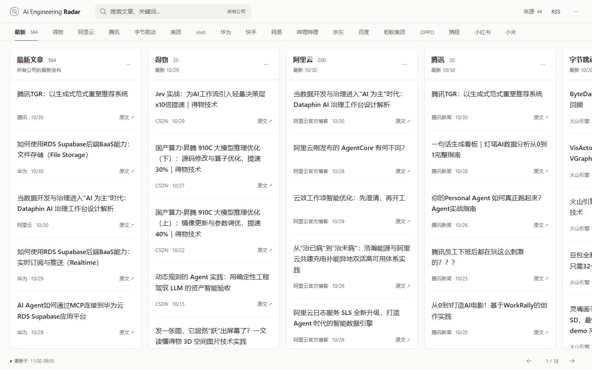
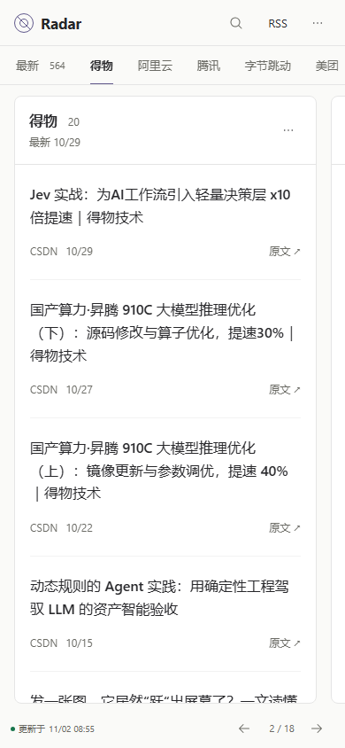

# AI Engineering Radar

聚合一线团队的 AI 工程实践，让值得学习的经验更容易被发现和持续追踪。

A radar for AI engineering practice from teams building and operating real systems. Follow official publications in company columns, discover new approaches, and learn from implementation choices and lessons from production. Browse columns side by side on desktop or swipe between them on mobile. This initial release follows teams at Chinese companies. Full articles stay on their original sites.

[网站](https://liuminxin45.github.io/ai-engineering-radar/) · [About / 关于](https://liuminxin45.github.io/ai-engineering-radar/about/) · [RSS](https://liuminxin45.github.io/ai-engineering-radar/feed.xml) · [Atom](https://liuminxin45.github.io/ai-engineering-radar/feed.atom) · [来源目录](https://liuminxin45.github.io/ai-engineering-radar/sources/)

## 为什么做这个项目

一线技术团队公开的实践，记录了 AI 从技术尝试走进真实业务的过程。这里有前沿方法的探索，也有架构取舍、部署经验、性能优化和踩坑复盘。许多具体的工程问题，可以从这些实践中找到值得借鉴的思路。

这些经验分散在公司技术博客、开发者社区和团队账号里。想持续跟进，往往需要记住多个入口，反复查看更新；有价值的文章也容易被错过，等到需要时又难以找回。

AI Engineering Radar 把这些分散的发布渠道聚集起来，持续追踪官方团队的新文章。希望每位开发者都能及时发现正在发生的工程探索，带着自己的问题去阅读、学习，再把合适的方法用到实践中。

## 如何使用

- **并排追踪公司**：打开[阅读看板](https://liuminxin45.github.io/ai-engineering-radar/)，先看“最新”列，再横向浏览各公司的文章。PC 可以同时看多列，每列独立上下滚动；手机左右滑动切换，也可以点击顶部公司名称或底部箭头定位。
- **带着问题查找**：搜索标题、摘要或作者，找到相关经验。手机点击搜索图标展开输入框；在更多菜单中切换最新或最早优先。
- **回到原文学习**：点击标题查看文章详情、发布主体和收录信息，点击“原文”阅读完整实现与适用条件。
- **持续追踪更新**：订阅[全站 RSS](https://liuminxin45.github.io/ai-engineering-radar/feed.xml) / [Atom](https://liuminxin45.github.io/ai-engineering-radar/feed.atom)，或在公司列菜单中订阅该公司的更新。

每列先显示 20 篇文章，滚动到底部可继续加载 20 篇。搜索、当前公司列和排序保存在链接中，支持刷新及浏览器前进后退，方便继续阅读或分享。

## 阅读界面

PC：公司分列，横向浏览。



手机：单列阅读，露出下一列边缘，提示可以左右切换。



## 收录范围与来源

首批仅收录国内公司官方技术团队。已核验且启用的官方来源文章直接建立索引，保留身份核验、去重和数据校验，不按内容相关性筛选，也不做自动主题分类。本批暂不接入海外来源。

来源包括国内公司自有技术站，也欢迎博客园、腾讯云开发者社区、阿里云开发者社区等第三方博客社区中的国内公司官方团队账号。公司归属依据具体发布主体核验，不按托管平台的域名推断。

来源是否经过身份核验、是否启用、是否采集成功是三个独立状态，均可在来源目录查看。待核验账号可以继续补充官方证据；缺少文章目录的入口可以继续贡献适配器。

来源还需要核查近期活跃度。HTTP 成功或能解析历史文章，不代表覆盖了近期更新。超过一个月没有新文章的渠道会人工复查。尚无可靠替代的过时来源暂停新增，保留历史；替代渠道已核验并真实采集后，移除指定旧源及仅由旧源支撑的文章，不按文章年龄自动删除。得物、阿里、字节、腾讯、网易、快手和蚂蚁的 7 个旧渠道已完成替换。第二轮新增蚂蚁百灵官网博客和 OceanBase 企业 CSDN 账号；百度的新 CSDN 候选尚缺账号归属证据，快手 InfoQ 企业号访问受限，均未启用采集。仍待补齐的来源见[来源核验记录](docs/source-research.md)。

不保存或提供文章全文，不提供登录、收藏、推荐榜单和评论。文章保留原始语言。

项目介绍见 [中文 / English About](docs/about.md)。欢迎[提交 PR 适配新来源](CONTRIBUTING.md)，也可以用[来源提议模板](https://github.com/liuminxin45/ai-engineering-radar/issues/new?template=source.yml)提供线索。

## 技术与运行方式

TypeScript、Node.js 24.19.0、pnpm workspace、Next.js 静态导出。全部业务状态使用带校验和的版本化 JSON，无数据库、ORM 或常驻后端。

`main` 保存代码和来源注册表。`data` 分支的 `snapshot/` 保存文章、来源状态及快照清单。Actions 每日北京时间 09:17 恢复快照，采集、构建和验证，通过后保存数据并部署 GitHub Pages。Actions 可能延迟执行，不能视为严格时间保证。

## 本地启动

需要 Node.js 24.19.0 和 pnpm 10.20.0。共享组件库从固定 Git 版本构建，要求此精确 Node.js 版本；本地与 CI 使用相同版本。

```sh
pnpm install --frozen-lockfile
pnpm data:init
pnpm ingest --force
pnpm export
pnpm dev
```

已有快照时跳过初始化。初始化命令会拒绝覆盖已有数据。默认数据目录为 `.radar/data`，可以通过 `RADAR_DATA_DIR` 指定其他目录。

不联网体验可运行测试夹具，但夹具仅用于开发，严禁作为线上内容发布：

```sh
pnpm test:fixture
# Set RADAR_DATA_DIR=.radar/fixtures before exporting the fixture snapshot.
pnpm export
pnpm dev
```

环境变量由 shell 或运行平台注入；参考 `.env.example`。命令行采集器不会自动加载 `.env` 文件。

## 构建与验证

```sh
pnpm registry:check
pnpm data:check
pnpm test
pnpm build
pnpm typecheck
pnpm check:public
pnpm exec playwright install chromium
pnpm test:e2e
```

浏览器验收服务器默认使用 `/ai-engineering-radar/`，运行对应测试前设置 `BASE_PATH=/ai-engineering-radar`、`SITE_URL=https://example.org` 并重新构建。验收覆盖横向浏览、列内滚动、搜索、加载更多、详情直达和 URL 恢复；包含桌面浅色、375px 手机深色及减少动态效果。

## 来源贡献与人工复核

欢迎提交 PR，补充国内官方来源、官方身份材料或已有来源的解析修复。完整步骤、字段说明及测试要求见 [贡献指南](CONTRIBUTING.md)。你可以先提供公开线索，再一起补全证据与适配器。

修改 `packages/source-registry/registry.json` 时，来源必须关联公司和发布主体；社区中的文章不得根据托管域名判断公司归属。

- A/B/C 为接入优先级，不等于身份已认证。
- `verified` 必须附带官方域名、官网反向链接或平台企业认证等证据、核验说明及日期。
- `pending` 不采集文章；`suspended` 停止新增并保留历史；`rejected` 来源不再作为公开文章的有效身份依据。
- 已完成替换的旧源从注册表及公开索引移除。迁移会先检查替代渠道的官方身份和实际采集记录，保留其他发布位置仍有效的文章及稳定 ID。
- RSS / Atom 优先；公开 API 及站点 HTML 解析必须使用经审核的入口和站点专用适配。
- 社区来源必须设置 `authorAllowlist`，匹配稳定可核验的发布主体；无法确认时保持禁用。

We welcome PRs for official engineering sources at Chinese companies, including team accounts hosted by third-party blogging communities. Overseas sources are outside this batch. Include the company, publisher, stable account ID, public evidence of ownership, permitted collection endpoint, and adapter fixtures with tests. See [CONTRIBUTING.md](CONTRIBUTING.md) for the current adapter requirements.

文章无需经过相关性规则或模型审核。发现归属、链接、日期或重复关系有误时，请提供原文地址与证据。`config/overrides.json` 可用于人工更正或隐藏记录；确定的同一发布主体跨平台重复可在 `merges` 添加 `from`、`into` 和 `reason`。相似标题只提示复核，不自动合并。

## 静态接口与订阅

所有路径均相对站点基路径。JSON 为公开快照，不接受服务端搜索或游标参数。

| 路径                              | 内容           |
| --------------------------------- | -------------- |
| `/data/articles.json`             | 已发布文章索引 |
| `/data/articles/{id}.json`        | 单篇元数据     |
| `/data/companies.json`            | 公司目录       |
| `/data/sources.json`              | 来源及检测状态 |
| `/data/health.json`               | 最近采集快照   |
| `/feed.xml`、`/feed.atom`         | 全站最近 50 篇 |
| `/feed/company/{id}.xml`、`.atom` | 公司订阅       |

订阅 ID 不随标题、URL 修改或站点域名变化。原文没有发布时间时使用发现时间，详情页明确说明。缓存及响应头由 GitHub Pages 管理。

## 部署、故障与恢复

参见 [运行维护](docs/operations.md) 和 [P0 设计](docs/design.md)。首次部署前必须建立 `data` 分支并存入合法的 `snapshot/`；自动化不会在读取失败时初始化空数据。

可以手动运行 **Collect and publish**：启用 `collect` 执行采集，关闭则仅从现有快照重新发布。单来源失败不会删除历史文章；全部来源采集失败会停止发布，保留线上版本。

## 许可与内容版权

代码采用 [MIT](LICENSE)。来源文章、摘要、名称和商标归相应权利人所有，不因本项目开源而重新授权。本站仅保存必要元数据及原站提供的短介绍，完整内容请访问原站。权利人可通过仓库 Issue 请求更正或移除。
